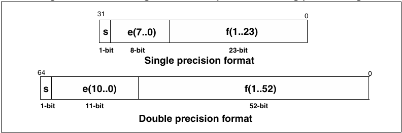
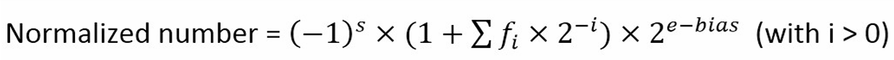
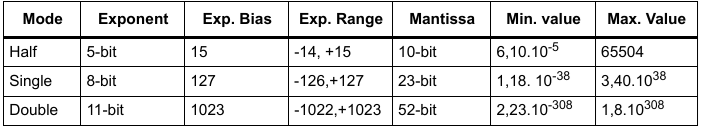

---
<h3 id="FPU" style="font-weight: bold;">ST-Floating Point Unit</h3>
Some STM32 microcontrollers have an internal FPU (Floating-Point Unit). It runs floating-point operations in hardware, which is much faster than the software emulation the compiler falls back to when there is no FPU.

Depending on the core, an ARM Cortex-M can have a single-precision FPU, a double-precision FPU, or none. On most cores the FPU is an optional feature, so check the specific chip's datasheet, not just the core name.
-  Single precision: M4, M33, M35P (optional)
-  Single or double precision: M7, M55 (optional)
-  No FPU: M0, M0+, M1, M23, M3
<h3 id="Overview" style="font-weight: bold;">Overview</h3>
The various types of floating-point implementations over the years led the IEEE to standardize the following elements:
-  number formats
-  arithmetic operations
-  number conversions
-  special values coding
-  four rounding modes
-  five exceptions and their handling

All values are composed of three fields:
-  Sign: s
-  Biased exponent: e = real exponent + bias (a constant that depends on the format)
-  Fraction (or mantissa): f
The values can be coded on various lengths:
-  16-bit: half precision format
-  32-bit: single precision format
-  64-bit: double precision format
{: .normal }
<h3 id="Normalized numbers" style="font-weight: bold;">Normalized numbers</h3>  
Normalized numbers are given by the formula below:
{: .normal }
For normalized numbers: value = (-1)^s × 1.f × 2^(e - bias). The exponent width and bias depend on the format: half has 5 exponent bits (bias 15), single has 8 (bias 127), double has 11 (bias 1023).
{: .normal }
<h3 id="Denormalized" style="font-weight: bold;">Denormalized</h3>  
Denormalized (or subnormal) numbers are used when the value to represent is too small to be encoded as a normalized number. In this case the exponent field is 0 and the implicit leading 1 is dropped: value = (-1)^s × 0.f × 2^(1 - bias). Precision shrinks as the value gets smaller, but the numbers go to zero gradually instead of jumping straight from the smallest normalized value to 0.

| Format | Min Denormalized Value |
|--------|-------------------------|
| Half   | ~5.96×10⁻⁸              |
| Single | ~1.4×10⁻⁴⁵              |
| Double | ~4.94×10⁻³²⁴            |

### Example 1: Convert Decimal to IEEE 754 Single-Precision  
**Input:** `-7.0`  
We'll convert `-7.0` to IEEE 754 **single-precision (32-bit)** floating-point format.

#### Step 1: Sign bit  
Since it's negative -> `Sign = 1`

#### Step 2: Convert to binary  
`7.0` in binary = `111.0` = `1.11 × 2²` (normalized form)

#### Step 3: Exponent  
- Bias for single precision = 127  
- Exponent = 2 -> `2 + 127 = 129`  
- `129` in binary = `10000001`

#### Step 4: Mantissa (23 bits)  
Keep the fraction part after the `1.` (since `1.` is implicit in normalized form)  
`1.11` -> take `.11` -> `11000000000000000000000`

####  Final IEEE 754 Format

| Sign | Exponent  | Mantissa                  |
|------|-----------|---------------------------|
| 1    | 10000001  | 11000000000000000000000   |

In Hex:
```
0b1_10000001_11000000000000000000000 = 0xC0E00000
```

---

### Example 2: Convert IEEE 754 Hex to Decimal  
**Input:** `0xC0E00000`

#### Step 1: Binary Breakdown  
`0xC0E00000` ->  
`11000000111000000000000000000000`

- Sign: `1` -> negative  
- Exponent: `10000001` -> 129  
- Mantissa: `11000000000000000000000`

#### Step 2: Compute Exponent  
`129 - 127 = 2`

#### Step 3: Compute Mantissa  
Add implicit `1.` in front -> `1.11`  
Binary `1.11` = `1 + 0.5 + 0.25 = 1.75`

#### Step 4: Final Result  
`Value = -1.75 × 2² = -7.0`

---

<h3 id="Special-Values" style="font-weight: bold;">Special Values in IEEE 754</h3>  
IEEE 754 defines several special cases in floating-point representation:

- Zero: Represented by all exponent and mantissa bits being 0. The sign bit determines +0 or -0.

- Infinity (±∞): Occurs when the exponent is all 1s and the mantissa is all 0s.

- NaN (Not-a-Number): Used to represent undefined or unrepresentable values such as 0/0 or sqrt(-1).

- Quiet NaN (QNaN): top bit of the fraction is 1. Propagates silently through most operations.

- Signaling NaN (SNaN): top bit of the fraction is 0. Raises the Invalid Operation exception when used.  

| Sign | Exponent | Fraction | Meaning     |
|------|----------|----------|-------------|
| 0    | 0        | 0        | +0          |
| 1    | 0        | 0        | -0          |
| x    | 0        | ≠0       | Denormalized|
| 0    | Max      | 0        | +∞          |
| 1    | Max      | 0        | -∞          |
| x    | Max      | ≠0       | NaN (Q/S)   |

<h3 id="Rounding" style="font-weight: bold;">Rounding Modes</h3>  
IEEE 754 specifies 4 rounding modes, which affect how results are approximated when they can't be represented exactly:

- Round to Nearest (default): Chooses the nearest representable value. If tie, rounds to even.

- Round Toward Zero: Truncates the result.

- Round Toward +∞: Rounds up.

- Round Toward −∞: Rounds down.

The mode is selected by the RMode bits [23:22] of FPSCR (FPDSCR holds the default value).

<h3 id="Exceptions" style="font-weight: bold;">Exception Handling</h3>  
Floating-point operations can raise exceptions in five situations:

- Invalid Operation (e.g., sqrt(-1), 0/0)

- Division by Zero

- Overflow (result exceeds the maximum value)

- Underflow (result is too close to zero to be normalized)

- Inexact Result (result had to be rounded)

In STM32:

- Cortex-M does not trap: the operation finishes and a sticky flag is set in FPSCR (IOC, DZC, OFC, UFC, IXC, plus IDC for denormal input).

- The flags stay set until you clear them, so read FPSCR and clear it yourself if you care.

- Some STM32 parts (e.g. F4) also route these to a dedicated FPU interrupt in the NVIC.

<h3 id="Examples" style="font-weight: bold;">Examples</h3>

**0.1 can't be stored exactly.** In binary, 0.1 is `0.000110011001100...` repeating forever, so single precision has to round it:
```c
float x = 0.1f;   // bits = 0x3DCCCCCD
                  // actual value = 0.100000001490116...
```
That's the "Inexact" exception from above: almost every decimal fraction triggers it.

**Precision runs out.** A float has 24 significant bits (23 + the implicit 1), so above 2^24 = 16777216 it can no longer represent every integer:
```c
float a = 16777216.0f;
float b = a + 1.0f;   // b == 16777216.0f, the +1 is rounded away
```
This is why a `float` counter or timestamp in milliseconds stops counting after about 4.6 hours.

**Special values in practice:**
```c
float zero = 0.0f;
float inf  = 1.0f / zero;    // +inf  (0x7F800000), sets DZC
float nan  = zero / zero;    // NaN   (0x7FC00000), sets IOC

if (nan != nan) { /* the only way to detect NaN without isnan() */ }
```

**Smallest denormal:** the bit pattern `0x00000001` is exponent 0, fraction 1, so its value is 2^-23 × 2^-126 = 2^-149 ≈ 1.4×10⁻⁴⁵, matching the table above.

**Reading the exception flags on Cortex-M:**
```c
__set_FPSCR(__get_FPSCR() & ~0x9FU);     // clear IOC, DZC, OFC, UFC, IXC, IDC
volatile float r = 1.0f / zero;
if (__get_FPSCR() & (1U << 1)) {         // DZC
    // a division by zero happened
}
```
