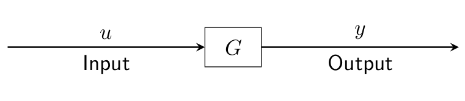
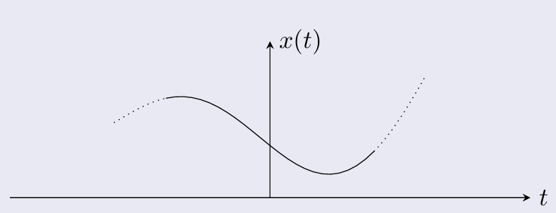
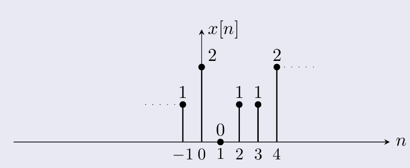
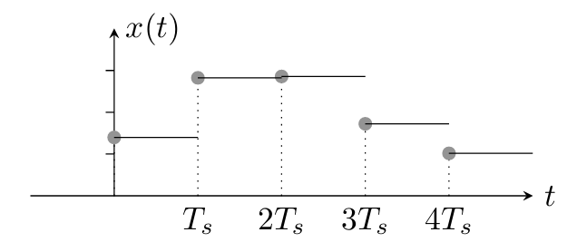

---

<h3 id="systems" style="font-weight: bold;">Hệ thống (Systems)</h3>

Một hệ thống $G$ tác động lên tín hiệu vào $u$ để tạo ra tín hiệu ra $y$, viết là $y = Gu$. 

---

<h3 id="signals" style="font-weight: bold;">Tín hiệu (Signals)</h3>

Tín hiệu là một hàm theo thời gian biểu diễn một đại lượng vật lý như lực, vị trí hay điện áp.

<figure style="text-align: center; margin: 20px 0;">
  
  <figcaption style="font-size: 0.9em; color: #666; margin-top: 8px;">Biểu diễn của một tín hiệu liên tục hình sin</figcaption>
</figure>

<figure style="text-align: center; margin: 20px 0;">
  
  <figcaption style="font-size: 0.9em; color: #666; margin-top: 8px;">Biểu diễn tín hiệu rời rạc</figcaption>
</figure>

| | Miền liên tục (CT) | Miền rời rạc (DT) |
|---|---|---|
| Ký hiệu | $x(t)$ | $x[n]$ |
| Biến  | $t \in \mathbb{R}$ | $n \in \mathbb{Z}$ |

---

<h3 id="sampling" style="font-weight: bold;">Lấy mẫu (Sampling)</h3>

Lấy mẫu tại các điểm cách đều nhau cho ra chuỗi DT

$$x[n] = x(nT_s) \quad \forall n \in \mathbb{Z}$$

trong đó $T_s$ là **chu kỳ lấy mẫu** và $f_s = 1/T_s$ là **tần số lấy mẫu**.

<h3 id="Hold" style="font-weight: bold;">Zero-order Hold</h3>

Ngược lại với lấy mẫu (**Sampling**), một tín hiệu liên tục có thể được phục hồi từ tín hiệu rời rạc bằng **zero-order hold (ZOH)**: "giữ" giá trị của tín hiệu rời rạc không đổi trong một chu kỳ lấy mẫu.

$$x(t) = x[n], \quad nT_s \le t < (n+1)T_s$$

Với ảnh minh họa như sau:

<figure style="text-align: center; margin: 20px 0;">
  
  <figcaption style="font-size: 0.9em; color: #666; margin-top: 8px;">Đây còn gọi là tín hiệu bậc thang</figcaption>
</figure>

> Có 1 phương pháp nữa là first-order hold, nôm na là mình sẽ nối các point value với nhau để đưa ra được hình dáng của tín hiệu gốc. Nhưng hiện tại bài này sẽ chỉ cover Zero-Order Hold thôi nhé!
{: .prompt-warning }

---

<h3 id="interface" style="font-weight: bold;">Giao tiếp giữa hệ CT và DT</h3>

Về mặt hình thức các phương pháp ADC hoặc DAC đã học để biến đổi các tín hiệu từ real-world sang thứ computer đọc được(hoặc ngược lại), đó là tập hợp của hold $H$ và lấy mẫu $S$:

$$\{u[n]\} \xrightarrow{H} \{u(t)\} \xrightarrow{G_c} \{y(t)\} \xrightarrow{S} \{y[n]\}$$

Cả chuỗi này có thể xem như một hệ DT duy nhất $G_d := S\,G_c\,H$.

Máy tính chỉ làm việc với các tín hiệu rời rạc, còn thế giới thực (âm thanh, điện áp, nhiệt độ...) thì liên tục. Nên là sẽ có những bộ chuyển đổi như ADC hoặc DAC để đảm nhiệm việc đó

- **ADC (Analog-to-Digital Converter)**: đọc tín hiệu thực tại những thời điểm $nT_s$ và đưa cho máy tính một chuỗi số. Đây chính là phép **lấy mẫu $S$**.
- **DAC (Digital-to-Analog Converter)**: nhận chuỗi số từ máy tính và xuất ra một mức điện áp, giữ nguyên mức đó cho đến mẫu kế tiếp. Đây chính là **zero-order hold $H$**.

---

<h3 id="audio" style="font-weight: bold;">Một mẫu tín hiệu audio</h3>

Lấy một nốt A 440 Hz, $x(t) = \sin(2\pi \cdot 440\, t)$, và lấy mẫu với $f_s = 44100$ Hz, tức $T_s \approx 22.7\ \mu s$:

$$x[n] = \sin\!\left(2\pi \cdot 440 \cdot \frac{n}{44100}\right)$$

| $n$ | 0 | 1 | 2 | 3 |
|---|---|---|---|---|
| $x[n]$ | 0 | 0.0626 | 0.1251 | 0.1870 |
| biểu diễn ở dải 16bit(2^15) | 0 | 2053 | 4098 | 6126 |

- Mỗi chu kỳ sẽ có khoảng $44100 / 440 \approx 100$ mẫu.
- **ADC**: lấy mẫu theo thời gian (cho $x[n]$), rồi **lượng tử hóa** từng mẫu thành số nguyên 16 bit. 
- **DAC** nhận lại dãy số nguyên đó, đổi thành điện áp và giữ không đổi trong $T_s$, tạo ra tín hiệu bậc thang như hình ở phần ZOH. Qua một bộ lọc làm mượt, ta nghe lại được âm thanh gần giống sóng sin ban đầu.
- Lấy mẫu càng dày ($T_s$ càng nhỏ) thì đồ thị bậc thang càng sát với tín hiệu gốc. Nếu lấy quá thưa so với tần số tín hiệu thì không thể khôi phục lại đúng được tín hiệu ban đầu
- Mấy phần này có trong quyển Kĩ thuật đo lường của HUST =))) Mình nhớ là vầy

